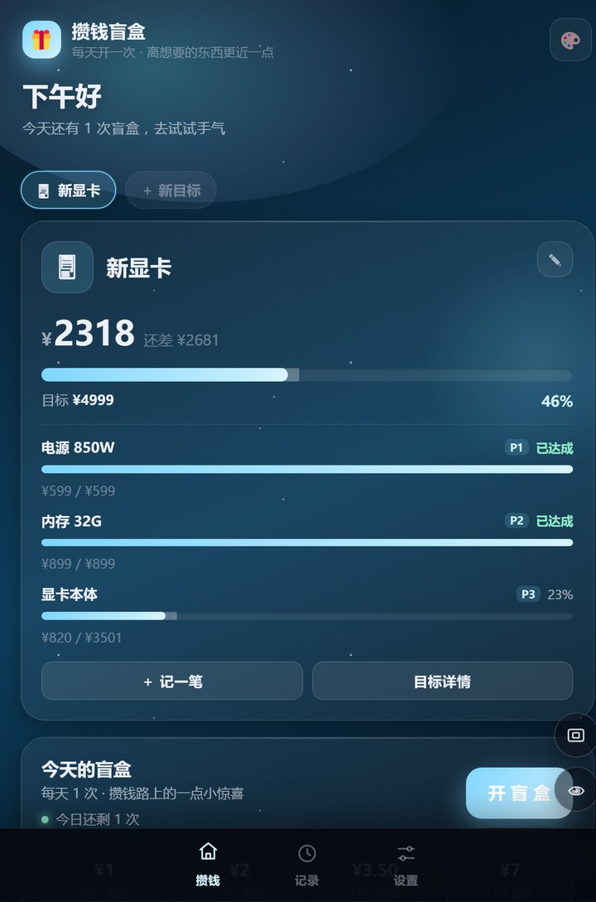
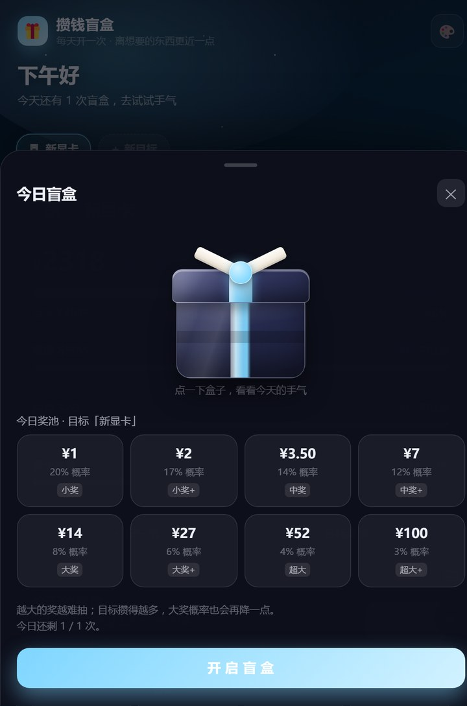
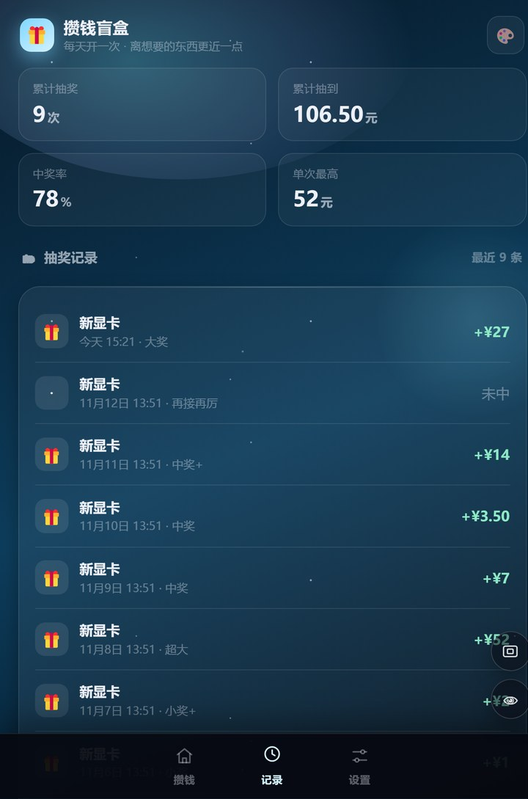
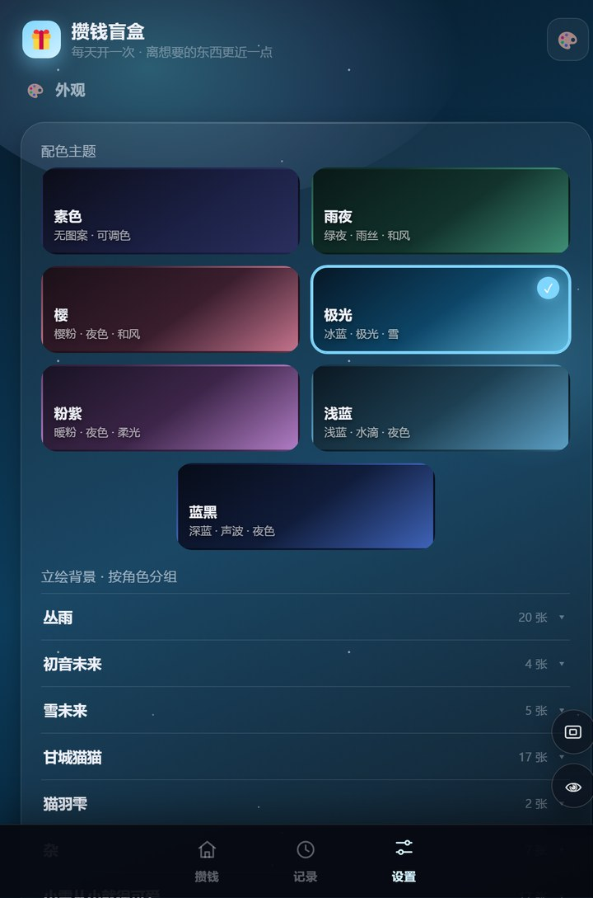

# 攒钱盲盒 · CoinBox

> 给想要的东西设一个目标，每天开一次盲盒，抽到的小奖金自动加进攒钱进度。

**纯本地记账 · 不付款 · 不收集任何数据**

[下载安装](#下载) · [怎么用](#怎么用) · [常见问题](#常见问题) · [开发文档](DEVELOPMENT.md)

   

## 这是什么

想买东西但总是攒不住钱？CoinBox 把攒钱变成一件有反馈的事：设一个目标（比如「新显卡 4999 元」），每天开一次盲盒，抽到几块到几十块不等的「小奖金」，这些钱会被记进你的攒钱进度里。

钱不会真的从你账户里扣，它是个**记账式的攒钱激励工具**——就像小时候在存钱罐里投硬币，只不过这里投的是「今天又攒了一点」的仪式感。

## 功能

**攒钱目标**
- 大目标可以拆成子目标，比如「新显卡」拆成「电源 / 内存 / 显卡本体」，每个子目标单独设金额和优先级
- 有子目标时，大目标金额会自动等于子目标合计，改子目标金额时一起变
- 抽到的钱按优先级先填 P1，填满了再填 P2，剩下的进大目标
- 子目标右侧的 ▲ / ▼ 点一下就上下挪一位，编号自动重排；首页的目标详情里点某个子目标也能直接改
- 目标或子目标攒够时，会弹一个恭喜动画

**每日盲盒**
- 每天 1 次（可在设置里改成 2 或 3 次），0 点自动刷新；也可以切换成「每个目标各 1 次」
- 每天生成 8 档奖金，从你设定的金额范围里取（默认 1~100 元），中间档位每天重新排布，首档=下限、末档=上限
- 没抽中档位也有 0.1 元安慰奖，不会空手
- 金额越大越难中；概率与已攒进度无关，同一天的奖池全天固定
- 同一天、同一个目标，结果固定不变，改系统时间也不会重抽

**界面**
- 7 套配色主题：素色 / 雨夜 / 樱 / 极光 / 粉紫 / 浅蓝 / 蓝黑，素色可自定义主色和底色
- 15 组角色立绘背景共 139 张，每张图自动提取主色，按钮和进度条跟着变色
- 背景可以换铺法：铺满裁切、完整显示（留白用同图模糊垫底）、模糊铺满、平铺重复、拉伸
- 背景能自己摆：设置 → 背景调整（隐藏界面时右下角的 ✥ 也能进），拖动平移、滚轮或双指缩放 100% ~ 300%，换窗口大小不跑位
- 右下角小眼睛可以一键隐藏所有界面，只剩清晰的背景图
- 隐藏界面后默认进入黑夜模式（整屏压暗），右下角月亮按钮可以切回原色，夜里看不刺眼
- 压暗能自己调：中心点位置、范围、强度都在设置里拖，默认最亮的一块在屏幕上方（人物头部）；每张背景各存一套，切回来自动还原，也能一键重置
- 5 种氛围特效：无 / 下雪 / 群星闪烁（约半分钟换一次星位）/ 波纹音符 / 樱花飘落（偶尔起一阵风），只在本机渲染
- 支持自己导入图片当背景：设置里「用户自添」分组可以一次选多张，每张单独存在本机、点卡片左上角 × 删除，随时切换
- 设置 → 关于里有「检查更新」（联网查 GitHub Release，8 秒超时会给提示）和「开源地址」

## 下载

到 [**Releases**](../../releases/latest) 页面下载对应系统的文件：

| 文件 | 适用 | 说明 |
|------|------|------|
| `CoinBox-1.0.5-x64-Setup-Inno.exe` | Windows 10/11 | 安装版，可选目录、建快捷方式、可从「应用和功能」卸载 |
| `CoinBox-1.0.5-x64-Portable.exe` | Windows 10/11 | 便携版，单个 exe 双击即用，不写注册表 |
| `CoinBox-1.0.5-Android.apk` | Android 5.1+ | 手机安装包，已锁定竖屏 |

**Windows 安装提示**：程序没有购买代码签名证书，首次运行 SmartScreen 可能提示「Windows 已保护你的电脑」。点「更多信息」→「仍要运行」即可。

**Android 安装提示**：属于第三方应用，需要在系统设置里允许「安装未知来源应用」。安装包是 Debug 签名，可直接覆盖升级。

## 怎么用

1. **新建目标**：首页点「+ 新目标」，填名字、金额，选个图标
2. **拆子目标**（可选）：进「目标详情」添加，设好优先级和金额
3. **设置金额范围**：设置 → 抽奖，默认 1~100 元，按自己的节奏改
4. **每天开一次**：首页点「开盲盒」，或者进「今日盲盒」点盒子

抽完可以在「记录」页看累计抽奖次数、累计抽到多少、中奖率和单次最高。

## 常见问题

**数据存在哪？换电脑怎么迁移？**
Windows 在 `%APPDATA%\CoinBox`，Android 在应用私有目录。换设备用「设置 → 数据 → 导出备份」，在新设备导入即可；自添的背景图也会一起导出、一起导回来。

**自添背景能放几张？**
图片会压到最长边 1440 再存，单张约 300~500KB，受本地存储 5MB 额度限制，一般 8~12 张。满了会提示，先删几张再加。

**卸载会删掉我的记录吗？**
Windows 卸载程序默认保留数据目录，重装后记录还在。想彻底清空，手动删掉 `%APPDATA%\CoinBox`。

**抽奖结果是真随机吗？**
是伪随机，但用「日期 + 目标 ID」做种子，所以同一天同一个目标的结果固定——不然反复开关应用就能刷大奖。

**会真的扣钱或联网吗？**
不会扣钱。平时完全离线，数据只存在本机；只有在设置 → 关于里主动点「检查更新」时，才会向 GitHub 查一次最新版本号（没有账号、不上传任何数据）。

**为什么看不到立绘背景？**
立绘素材有版权，不随代码仓库分发。自己编译的话，按 [`public/backgrounds/README.md`](public/backgrounds/README.md) 放图；用 Releases 里的安装包则自带全部 139 张。

**字体或界面显示不正常？**
Windows 需要系统装有微软雅黑等中文字体；Android 5.x 的 WebView 较老，动效会弱一些，可在设置里开「减少动画」。

## 素材与版权

- 配色主题、粒子、光效、界面均为本项目原创（CSS + Canvas 实现），不含第三方素材
- 立绘背景为角色同人作品，来自公开分享，**角色与画师版权归原权利人所有**，因此不随仓库分发；若你是权利人希望移除，请开 issue 联系
- 应用图标为作者提供的二次元插画

## 许可证

Copyright (C) 2026 Aerdgareo

代码以 **GNU General Public License v3.0 或更新版本**（`GPL-3.0-or-later`）开源，协议全文见 [LICENSE](LICENSE)。

This program is free software: you can redistribute it and/or modify it under the terms of the GNU General Public License as published by the Free Software Foundation, either version 3 of the License, or (at your option) any later version.

This program is distributed in the hope that it will be useful, but WITHOUT ANY WARRANTY; without even the implied warranty of MERCHANTABILITY or FITNESS FOR A PARTICULAR PURPOSE. See the GNU General Public License for more details.

> 简单说：可以自用、可以改，但**分发修改版时必须同样以 GPL 开放源代码**，并保留版权与协议声明；不能把改过的版本闭源发布。

立绘背景素材不在授权范围内——它们属于各自的画师与角色权利人，仅随 Releases 的安装包提供个人使用，请勿二次分发或商用。

## 开发

见 [DEVELOPMENT.md](DEVELOPMENT.md)：本地运行、构建 Windows / Android 安装包、素材流水线、目录结构。
